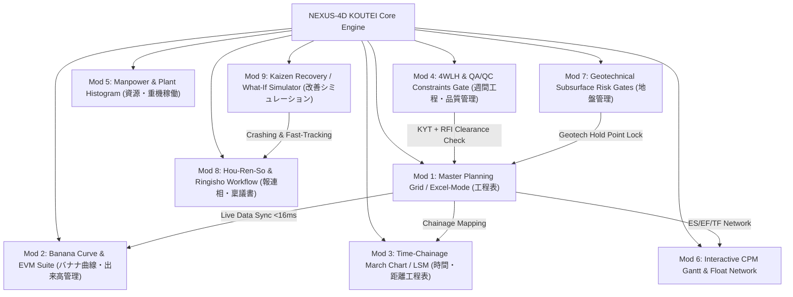

# PRODUCT REQUIREMENTS DOCUMENT (PRD) & UI REQUIREMENTS DOCUMENT (UIRD)
## System: `NEXUS-4D™ KOUTEI | Enterprise Project Controls & Linear Scheduling Engine`
**Document Version:** 5.2.0 (Shimizu Monozukuri Edition — MS Project Unified Ingestion Middleware & 3-Tier Approval Gate) | **Date:** November 2026  
**Project Scope:** Jakarta Mass Rapid Transit (MRT) Underground Package CP-202 (Station Box & TBM Drive Section)  
**Engineering Standard:** Shimizu Corporation Monozukuri Quality / ISO 21502 / PMI PMBOK 7th Ed. / FIDIC Red Book  
**Classification:** Enterprise Engineering Specification (PE26 / QC26 / GEO-ENG Tailored)  
**Status:** Approved & Synchronized with Active Dashboard Implementation

---

## 1. EXECUTIVE PRODUCT CONCEPT & SYSTEM OBJECTIVE

### 1.1 The Heavy Infrastructure Challenge
On mega underground infrastructure projects (e.g., Underground MRT, Deep Station Boxes, and TBM Bored Tunnels), conventional project controls fail due to four structural disconnects:
1. **The "Excel-Primavera Friction":** High-level CPM networks in Primavera P6 or MS Project lack field responsiveness, forcing planning engineers to maintain disconnected, fragile daily tracking spreadsheets.
2. **The Linear Scheduling Gap:** Standard Gantt charts cannot adequately represent continuous linear works (e.g., TBM drive tunneling and Diaphragm Wall trenching). A project requires a **Time-Location / Time-Chainage Chart (March Chart / 時間・距離工程表)** to detect spatial-temporal clashes between adjacent equipment.
3. **The Subsurface & Quality Blindspot:** Civil excavation schedules frequently crash because geotechnical hazards (boulder anomalies, high water inflow, wall lateral deflection) and safety/quality hold-points (*Kiken Yochi / KYT* and *Request for Inspection / RFI*) are managed in isolation rather than as hard dependencies on the critical path.
4. **Cultural Misalignment in Governance:** Multi-national joint ventures often struggle with decision escalation. Japanese general contractors (such as Shimizu Corporation / 清水建設) rely on disciplined **Anzen Dai-Ichi (安全第一)**, **Genba-Shugi (現場主義)**, **Hou-Ren-So (報連相)**, and **Ringisho (稟議書)** consensus workflows that require structured variance telemetry.

### 1.2 System Solution: `NEXUS-4D™ KOUTEI (工程)`
`NEXUS-4D™ KOUTEI` is an integrated, single-pane project controls cockpit designed for Senior Planning & Project Controls Specialists (`PE26`), QA/QC Leads (`QC26`), and Geotechnical Engineers (`GEO-ENG`). It merges spreadsheet agility, linear tunneling analytics, subsurface risk gates, and Japanese construction management discipline into a unified, zero-latency (`<16ms` reactive recalculation) platform.



---

## 2. DETAILED PRODUCT REQUIREMENTS DOCUMENT (PRD)

### 2.1 User Personas & Role Matrix
| Persona Code | Role Description | Key Dashboard Interactions |
| :--- | :--- | :--- |
| **PE26 (Planning Lead)** | Senior Planning & Project Controls Engineer | Updates WBS dates, weight factors (*bobot %*), and actuals inline; runs Weekly Cut-off variance analysis; analyzes Banana Curve envelopes and Linear Scheduling March Charts. |
| **QC26 (QA/QC Lead)** | Quality Assurance & Quality Control Specialist | Signs off RFI (*Request for Inspection*) and KYT (*Kiken Yochi*) hold points; manages NDT ultrasonic weld verification and bentonite slurry QA gates. |
| **GEO-ENG (Geotech Lead)** | Ground Risk & Geophysical Specialist | Validates borehole (`BH-01` to `BH-14`) strata profiles, N-SPT values, ERT resistivity anomalies, piezometer drawdown, and inclinometer lateral deflection limits. |
| **SITE-AGENT / PD** | Project Director (Japanese Expat / Shimizu HQ) | Evaluates high-level SPI/CPI/TCPI/EAC indices; reviews Hou-Ren-So escalations; stamps formal Ringisho (稟議書) *Hanko* budget and schedule variance approvals. |

---

### 2.2 Mathematical & Analytical Formulations

#### A. Weight Factor Normalization
Each WBS item $i$ carries a contract weight factor $W_i$ (*Bobot %*) normalized to the total contract sum:
$$\sum_{i=1}^{n} W_i = 100.00\%$$
*Weighted Earned Progress ($EV_{\%}$)* and *Weighted Planned Progress ($PV_{\%}$)* at cut-off are calculated as:
$$EV_{\%} = \sum_{i=1}^{n} \left( \frac{W_i \times \text{Actual Progress}_i}{100} \right), \quad PV_{\%} = \sum_{i=1}^{n} \left( \frac{W_i \times \text{Planned Progress}_i}{100} \right)$$

#### B. Earned Value Management (EVM) Core Metrics
Given a Budget at Completion ($BAC = \text{IDR } 420.00\text{ Billion}$):
1. **Planned Value ($PV$):** $PV = (PV_{\%} / 100) \times BAC$
2. **Earned Value ($EV$):** $EV = (EV_{\%} / 100) \times BAC$
3. **Actual Cost ($AC$):** $AC = \text{Certified Field Expenditures to Date}$
4. **Schedule Variance ($SV$) & Cost Variance ($CV$):**
   $$SV = EV - PV, \quad CV = EV - AC$$
5. **Schedule Performance Index ($SPI$):** $SPI = \frac{EV}{PV} \quad (\ge 1.00 \text{ On Track}, < 0.95 \text{ Lagging})$
6. **Cost Performance Index ($CPI$):** $CPI = \frac{EV}{AC} \quad (\ge 1.00 \text{ Within Budget})$
7. **Estimate at Completion ($EAC$):**
   $$EAC_{\text{cost}} = \frac{BAC}{CPI}, \quad EAC_{\text{composite}} = AC + \frac{BAC - EV}{CPI \times SPI}$$
8. **To-Complete Performance Index ($TCPI$):**
   $$TCPI = \frac{BAC - EV}{BAC - AC}$$

#### C. Banana Curve Envelope Formulation (バナナ曲線)
To ensure the schedule maintains adequate float buffers without relying on an overly optimistic single planned line:
- **Early Dates Curve ($S_{Early}(t)$):** Computed assuming all WBS activities commence at their Early Start ($ES$) and finish at Early Finish ($EF$).
- **Late Dates Curve ($S_{Late}(t)$):** Computed assuming all WBS activities are delayed by their CPM Total Float ($LS = ES + TF$, $LF = EF + TF$).
- **Acceptance Criterion:** The cumulative physical actual curve $S_{Act}(t)$ must remain strictly inside the boundary:
  $$S_{Late}(t) \le S_{Act}(t) \le S_{Early}(t)$$
  *If $S_{Act}(t) < S_{Late}(t)$, the project has entered the negative float zone and mandatory Kaizen recovery procedures must initiate.*

#### D. Linear Scheduling Method (LSM) / Time-Chainage March Equations
For continuous tunneling works along alignment chainage $X$ (meters, $\text{STA } 14+000$ to $\text{STA } 15+500$) across time $t$ (days):
$$X_{tbm}(t) = X_0 + \int_{0}^{t} v_{tbm}(\tau) \cdot (1 - \eta_{down}) \, d\tau$$
Where:
- $X_0 = \text{STA } 14+350$ (TBM Launch Shaft North Headwall)
- $v_{tbm} = 12.5\text{ m/day}$ (Nominal advance velocity across 24-hr dual shift)
- $\eta_{down} = \text{Planned downtime ratio for precast concrete ring erection & cutterhead inspection (18\%)}$

---

### 2.3 Core Feature Specifications

#### Module 1: Master Planning Grid (工程表) & Weekly Cut-Off Telemetry
- **Inline Spreadsheet Editing:** Full keyboard-accessible data grid (`Tab`, `Shift+Tab`, `Enter`, `ArrowUp`, `ArrowDown`) for WBS Code, Activity Name, Start/Finish Dates, Total Float, Weight (*Bobot %*), Last Week %, Planned %, and Actual %.
- **Auto-Calculations (`<16ms`):** Duration ($EF - ES + 1$), Weighted Earned %, Weekly Delta ($\Delta_{\text{week}}$), Variance %, and Weight Auto-Balancer ($100.00\%$).
- **Anzen Dai-Ichi (安全第一) & RFI Hold-Point Enforcement:** Progress updates on activities flagged with `RFI HOLD` or `GEO HOLD` trigger an automatic quality/safety gate lock until cleared by QC26/GEO-ENG.
- **Genba-Shugi (現場主義) Inspector Log Modal:** 1-to-1 drill-down from any WBS row to verified daily field logs (N-SPT blow counts, slurry sand content, concrete slump, TBM thrust/torque).

#### Module 2: Banana Curve & EVM Analytics Suite (出来高管理)
- Dual-baseline interactive canvas displaying **Early Curve** (dashed blue), **Late Curve** (dashed purple), **Actual EV Curve** (emerald solid with fill), and **Kaizen Forecast Curve** (amber dotted).
- Monthly EVM profile bar charts ($PV$ vs $EV$ vs $AC$) and FIDIC Red Book Contract Milestone countdowns with Liquidated Damages (LD) exposure telemetry.

#### Module 3: Time-Chainage March Chart (時間・距離工程表)
- Dedicated LSM visualizer plotting station chainage coordinates ($\text{STA } 14+000$ to $\text{STA } 15+500$) against project timeline months.
- Visualizes spatial-temporal progression and separation buffers between D-Wall trenching, Top-Down Station Box excavation/strutting, TBM #1 ("Sakura-1" Northbound), TBM #2 ("Garuda-2" Southbound), and the BH-09/ERT boulder anomaly zone ($\text{STA } 14+780\text{–}14+860$).

#### Module 4: 4-Week Rolling Lookahead (4WLH) & Make-Ready Constraints
- Operational crew coordination schedule covering 4 rolling weeks (`W42` to `W45`).
- **Make-Ready Constraint Checklist:**
  1. *Shop Drawing Approval Status* (`Approved Code A`, `Code B`, `Rev-2 Submitted`)
  2. *Permit to Work / KYT (Kiken Yochi Hazard Prediction)* (`KYT Signed & Valid`, `Expiring 3d`, `Hold`)
  3. *PE26/QC26 RFI Quality Gate* (`RFI Approved`, `Inspection Pending`, `NDT Weld QA`, `Hold Point`)
  4. *Material Rebar & Precast Readiness* (`On Site`, `H-Beams at Yard`, `Segments Cured`)

#### Module 5: Manpower & Heavy Equipment Histogram (資源・重機稼働)
- Visual histogram comparing Budgeted vs Mobilized direct labor headcount across trades (Steel Fixers, Heavy Operators, TBM Shield Crew, Muck Excavation Crew, Carpenters, QA/QC).
- Critical heavy plant telemetry tracking utilization and quality parameters:
  - *Hydrofraise Bauer BC 40* (D-Wall trench cutter — verticality `0.12%`)
  - *Kobelco CKE2500G-2* (250t Crawler Crane — rebar cage & king-post hoisting)
  - *Komatsu PC300* (Long-reach top-down mucking excavators)
  - *Bentonite Slurry Desanding Plant* (Specific gravity `1.04–1.11 g/cm³` and sand content `1.8%` QA metrics)

#### Module 6: Interactive CPM Gantt & Float Network
- Visual horizontal timeline bar chart synchronized in real time with the Master Planning Grid, displaying Early bars, Total Float tails, Critical Path (`TF = 0`) highlights, progress fills, and the active Data Date line.

#### Module 7: Geotechnical Subsurface Risk Gates (地盤管理)
- Cross-references civil excavation with borehole investigation (`BH-01` to `BH-14`, N-SPT, ERT resistivity anomalies).
- Live instrumentation monitoring: Inclinometer lateral deflection (`INC-04`), building settlement (`SM-08`), piezometric drawdown (`PZ-02`), and strut load cells (`LC-S2-09`).
- 3-Tier QA/QC verification policy (`GEO-ENG` → `QC26` → `PE26`) required before excavation clearance.

#### Module 8: Hou-Ren-So (報連相) & Ringisho (稟議書) Workflow
- **報告 (Hōkoku):** Objective factual reporting of root cause delays when $SPI < 1.0$.
- **連絡 (Renraku):** Proactive lateral notice to downstream MEP, structural steel, and precast trades.
- **相談 (Sōdan):** Solution consultation presenting evaluated recovery options to the Project Director.
- **Ringisho (稟議書):** Formal consensus memorandum tracking budget/schedule variance with interactive Japanese *Hanko* (印鑑) approval stamps.

#### Module 9: Kaizen Recovery Simulator (改善シミュレーション)
- Interactive sliders comparing **Schedule Crashing** (24/7 night-shift muck haulage), **Fast-Tracking** (off-site strut prefabrication), **2nd Cutter Rig Mobilization**, and **Geotechnical Stress Testing**.
- Real-time calculation of recovered calendar days, simulated $SPI$, simulated $EAC$, and Net Cost-Benefit vs avoided Liquidated Damages.

---

## 3. USER INTERFACE REQUIREMENTS DOCUMENT (UIRD)

### 3.1 Design System & Japanese Engineering Tokens
- **Theme:** Obsidian Dark Industrial (`#070b14` Core Background, `#0c1322` Card Surfaces, crisp `#1e293b` borders).
- **Brand Identity:** Shimizu Corporate Navy (`#005bac`), Safety Green (`#00875a`), Critical Crimson (`#c5221f`), Subsurface Amber (`#d97706`).
- **Typography:** `Inter` (UI/Headings) + `JetBrains Mono` (Numeric telemetry, dates, station chainages).
- **Bilingual Terminology System:** Authentic Japanese construction industry Kanji labels (進捗率, 週間進捗, 工程管理, 出来高管理, 地盤管理, 完成時予測, 安全第一, 現場主義, 報連相, 稟議書).

### 3.2 Information Architecture (IA) Layout Map
```
+--------------------------------------------------------------------------------------------------------+
| [SHMZ 清水] NEXUS-4D™ KOUTEI  |  CP-202 STATION & TUNNEL  |  安全第一: 1,240,000 LTI-FREE  |  [PRINT] [CSV] [ADD] |
+--------------------------------------------------------------------------------------------------------+
| [PHYSICAL % (進捗率)]  [WEEKLY CUT-OFF (週間)]  [SPI (工程効率)]  [CPI (原価効率)]  [EAC (完成予測)]  [GROUND GATE] |
| 44.85% (Δ -3.35%)     Act +0.65% (Lag -0.45%)  0.931 (Lagging)    1.022 (On Budget) IDR 410.95 B      12/14 BH Cleared  |
+--------------------------------------------------------------------------------------------------------+
| NAVIGATION TABS:                                                                                       |
| [1. 工程表 (Master Grid)]  [2. バナナ曲線 (Banana Curve)]  [3. 時間・距離 (March Chart)]  [4. 4WLH & QC]        |
| [5. 資源 (Resources)]     [6. CPM Gantt]               [7. 地盤管理 (Ground Risk)]    [8. 報連相 (HouRenSo)]|
| [9. 改善 (Kaizen Simulator)]                                                                           |
+--------------------------------------------------------------------------------------------------------+
| ACTIVE CONTENT VIEWPORT                                                                                |
| - Excel inline editable spreadsheet / Responsive Chart.js vector canvases / Clean Japanese styling     |
+--------------------------------------------------------------------------------------------------------+
| STATUS FOOTER: In-Memory Zero-Latency Recalc Active | 100% Verifiable Data Lineage | Autosaved Locally |
+--------------------------------------------------------------------------------------------------------+
```

### 3.3 Print / PDF Executive 1-Pager Specification
- **Print Trigger:** Top-right `Print / PDF (1-Pager)` action button invoking `window.print()`.
- **CSS `@media print` Rules:**
  - Hides interactive navigation bars, filter toolbars, action buttons, and footers (`.no-print`).
  - Forces high-contrast white paper styling with crisp dark borders for A4 Landscape executive steering committee sheets.
  - Consolidates Executive KPIs, Weekly Cut-off Variance, Critical WBS Summary, Geotechnical Hold Status, and Ringisho Hanko Approval Block onto a single page.

---

## 4. ARCHITECTURAL & DEPLOYMENT VERIFICATION (GITHUB & VERCEL)

1. **Zero-Dependency Portability:** Standalone HTML5 / Tailwind CSS / Chart.js single-file architecture located at root `index.html` and mirrored at `nexus4d-planning-engine/index.html`.
2. **Local Persistence:** Dual-layer storage using an in-memory reactive state engine (`<16ms` compute cycle) with automatic `localStorage` persistence and instant CSV/Excel export.
3. **GitHub & Vercel Static Hosting:** Configured via `vercel.json` for zero-build instant edge deployment on Vercel and GitHub Pages.
